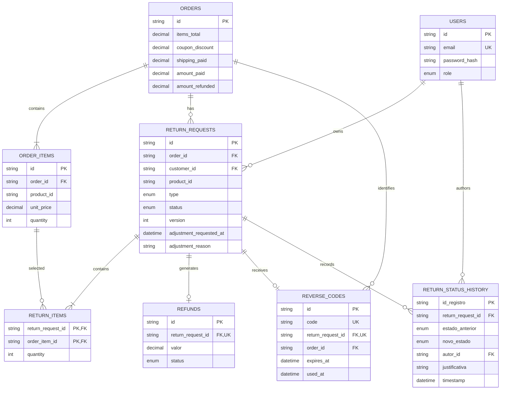
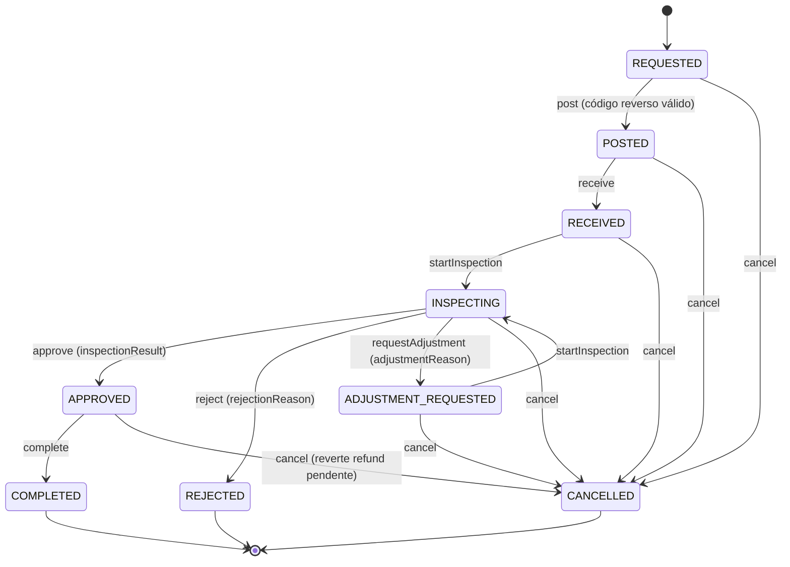

# Devoluções E-commerce

Backend para abertura e acompanhamento de devoluções e trocas, com transições controladas, autorização por papel, histórico de auditoria e cálculo de estorno proporcional.

## Tecnologias

- NestJS e TypeScript
- PostgreSQL e Prisma
- bcryptjs para hashes de senha
- JWT HS256 para autenticação
- Jest para testes unitários e de integração
- Docker Compose para PostgreSQL local

## Arquitetura

O módulo `returns` separa responsabilidades em quatro camadas:

- `domain`: entidade, estados, regras de transição, erros e estratégia pura de cálculo. Não depende de NestJS ou Prisma.
- `application`: serviços, DTOs e casos de uso.
- `infrastructure`: persistência Prisma e transações PostgreSQL.
- `presentation`: rotas HTTP, autenticação e autorização.

As transições são registradas em `return-transition-rules.ts`. O repositório aplica controle otimista por versão e grava a alteração, os efeitos financeiros e o histórico na mesma transação quando necessário.

## Modelo de dados (DER)



## Máquina de estados



## Regras principais

- O estado só muda pelas ações explícitas da FSM; atualização concorrente exige a versão e o estado de origem esperados.
- `REJECTED` e `COMPLETED` são terminais. Cancelamento só é permitido até `APPROVED`.
- A matriz RBAC está declarada como dados em `RETURN_ACTION_PERMISSIONS`. Clientes só criam e operam as próprias devoluções.
- Códigos reversos são aleatórios, únicos, vinculados à devolução e ao pedido, e expiram em sete dias por padrão. O prazo pode ser configurado por `RETURN_CODE_TTL_DAYS`.
- `post` valida e consome o código na mesma transação da mudança de estado e auditoria. Código inexistente ou expirado retorna 422; código usado/conflito retorna 409.
- Auditoria é obrigatória em cada transição. `reject`, `requestAdjustment` e `cancel` registram a justificativa informada; as outras ações usam uma justificativa padrão.
- O desconto do cupom é distribuído proporcionalmente por item em centavos, com resto pelo método do maior resto. Trocas não geram estorno. O frete pago só entra no estorno quando todas as quantidades do pedido tiverem sido devolvidas. O total estornado nunca excede o valor pago.
- Aprovação de devolução cria refund `PENDING`; conclusão muda para `PAID`. Cancelamento de uma devolução aprovada muda refund pendente para `REVERSED` e libera o valor reservado.

## Execução local

Pré-requisitos: Node.js, npm e PostgreSQL local ou Docker Desktop. O banco de desenvolvimento é PostgreSQL, banco `devolucoes`, na porta `5432`. O projeto lê o `.env` existente na raiz; não versione esse arquivo.

### 1. Subir PostgreSQL (opcional)

Se já houver PostgreSQL local disponível, pule o Docker. Caso use Compose, ajuste `POSTGRES_USER` e `POSTGRES_PASSWORD` no ambiente para corresponderem ao banco configurado no `.env`; o serviço cria o banco `devolucoes`.

```powershell
docker compose up -d postgres
```

Para parar o container sem apagar os dados:

```powershell
docker compose stop postgres
```

Não use `docker compose down -v` se precisar preservar o banco.

### 2. Instalar dependências e preparar o banco

Na raiz do repositório:

```powershell
npm --prefix ppw_server install
npx --prefix ppw_server prisma migrate dev --schema ppw_server/prisma/schema.prisma
npx --prefix ppw_server prisma db seed --schema ppw_server/prisma/schema.prisma
```

Defina `JWT_SECRET` no ambiente antes de iniciar a API. Exemplo para a sessão atual do PowerShell:

```powershell
$env:JWT_SECRET = ([guid]::NewGuid().ToString('N') + [guid]::NewGuid().ToString('N'))
$env:RETURN_CODE_TTL_DAYS = '7'
```

### 3. Executar API e testes

```powershell
npm --prefix ppw_server run start:dev
npm --prefix ppw_server run build
npm --prefix ppw_server test -- --runInBand
```

Os testes PostgreSQL ficam desativados por padrão. Com o banco local e as migrations aplicadas, podem ser habilitados assim:

```powershell
$env:RUN_POSTGRES_INTEGRATION_TESTS = '1'
npm --prefix ppw_server test -- --runInBand
Remove-Item Env:RUN_POSTGRES_INTEGRATION_TESTS
```

### Usuários locais de demonstração

O seed cria/atualiza estes usuários de desenvolvimento:

| Papel | E-mail | Senha local |
|---|---|---|
| CUSTOMER | `customer@returns.local` | `Customer123!` |
| INSPECTOR | `inspector@returns.local` | `Inspector123!` |
| FINANCE | `finance@returns.local` | `Finance123!` |
| ADMIN | `admin@returns.local` | `Admin123!` |

Use-os somente em ambiente local. A autenticação é `POST /auth/login`; as ações de devolução exigem o token Bearer retornado.
